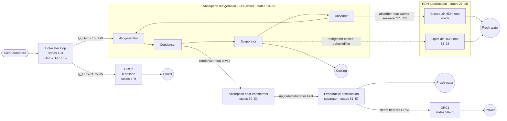
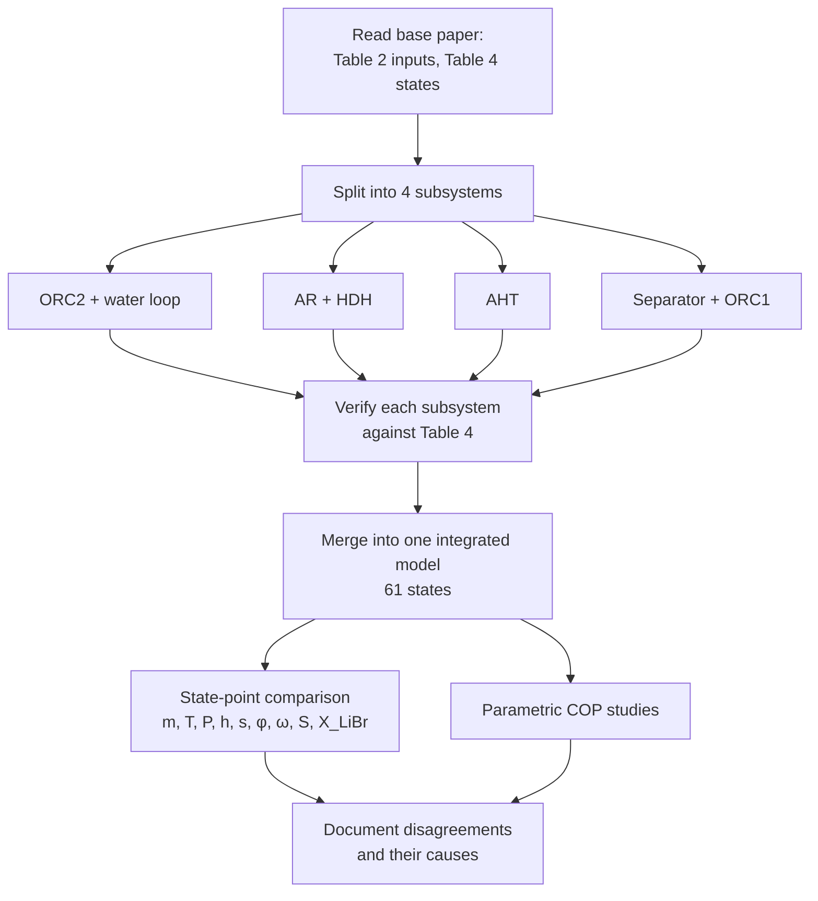
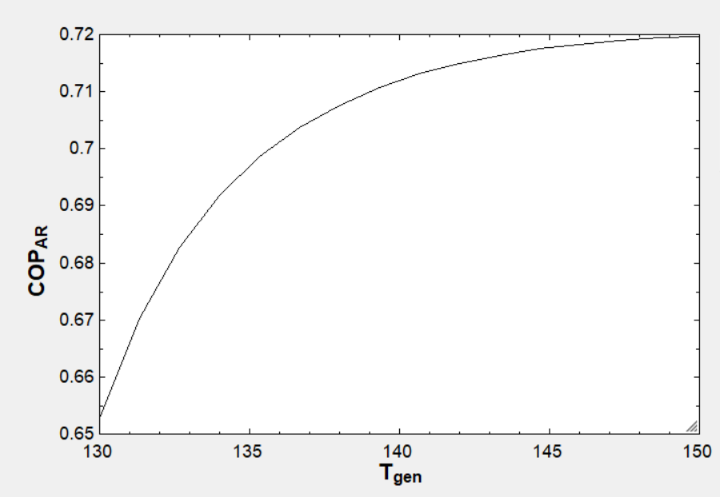
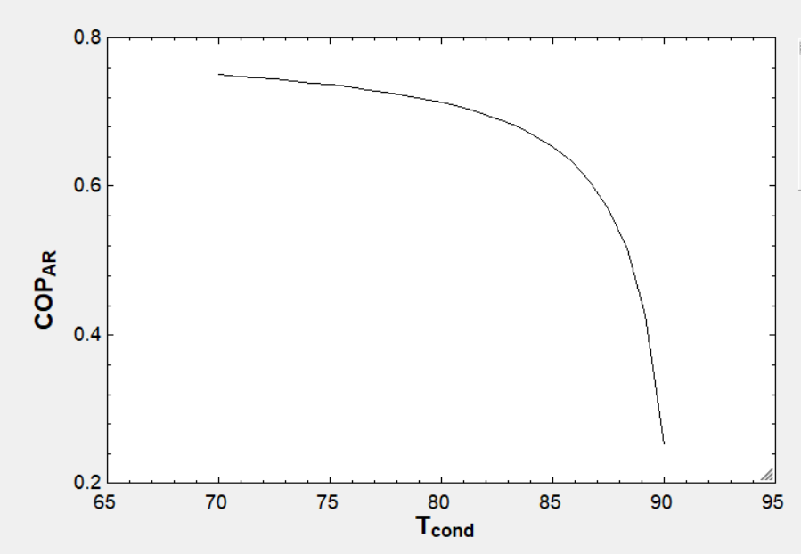
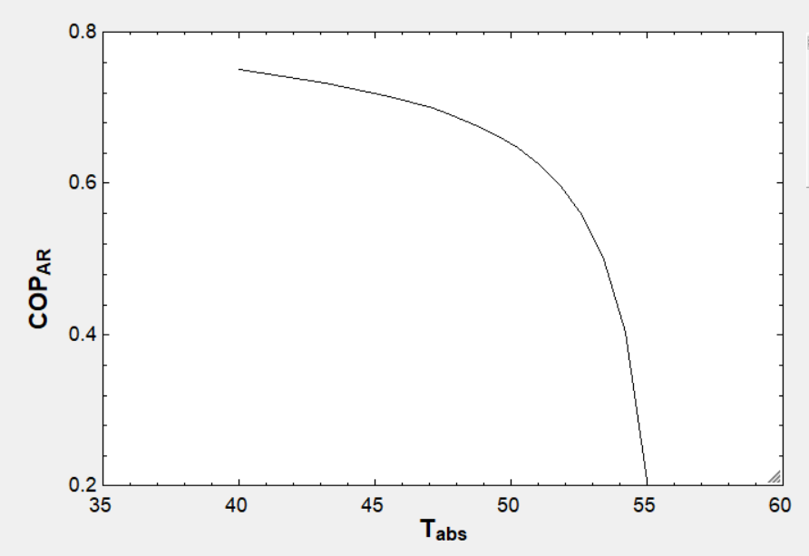
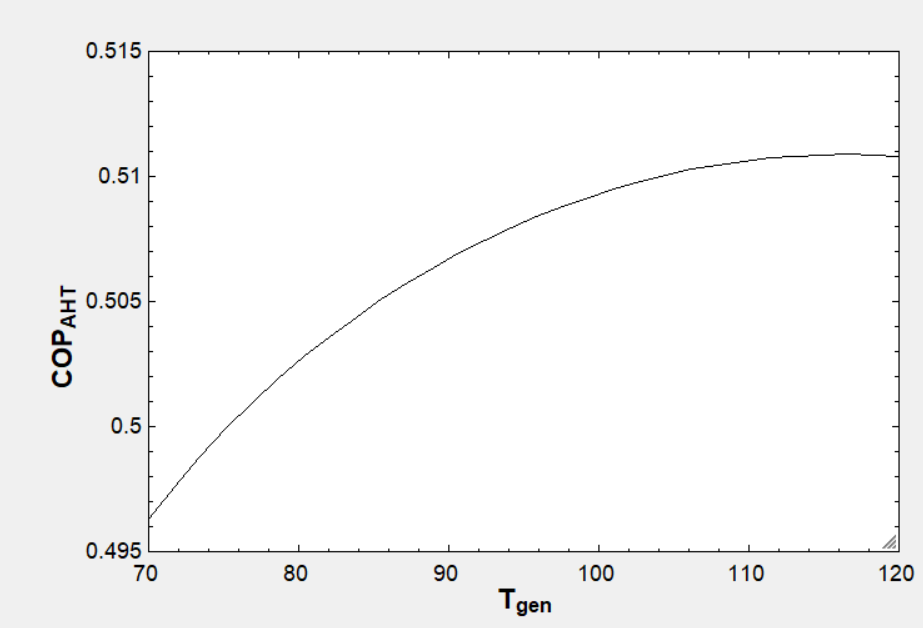
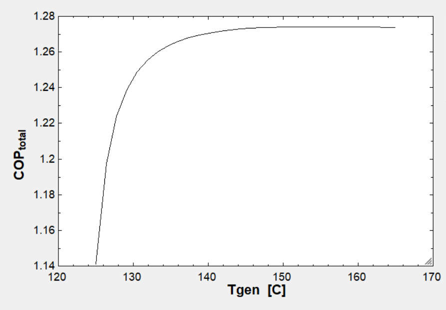

# Solar-Assisted Multigeneration System: Independent Model Validation in EES

**Power, cooling and fresh water from one solar field: rebuilding and checking a published thermodynamic model, state point by state point.**
Complex Engineering Problem (CEP), Power Plant Engineering (ME 4805), Islamic University of Technology (IUT), August 2026.

| | |
|---|---|
| **Base paper** | S. Salehi and F. Javanfam, "Investigation of a novel solar-assisted multigeneration system comprising water desalination systems, an absorption refrigeration system, a single-effect absorption heat transformer and two organic Rankine cycles," *Heliyon* 10 (2024) e36452 |
| **Team (Group 6, Sec B)** | Hazzaz Johaer Alamin, Imran Khan, Muhammad Muhtasimur Rahman, **Mehdi Hasan**, Basim Raiyan Apon, Junaid Rahman Fahim |
| **Tool** | Engineering Equation Solver (EES) |
| **Scope** | 4 subsystem models + 1 integrated model · **61 state points** · 10 properties per state |
| **Outcome** | Close agreement at most state points; **6 inconsistencies** found in the published paper |

### Validation at a glance

| Property | Agreement with the paper |
|---|---|
| Pressure | within **0.1 %** at all 61 states |
| Temperature, enthalpy, entropy | within 1 % at ≈ ⅔ of states; within 5 % at ≈ 80 % |
| Mass flow, water loop + ORC2 (states 1–9) | within 0.2 % |
| Mass flow, AR / AHT / separator / ORC1 (10–25, 39–61) | 13–21 % lower, a consistent offset pointing to a different mass basis in the paper |
| Humidity, humidity ratio, salinity | almost exact |
| LiBr concentration (back-calculated) | within ≈ 1 percentage point at every LiBr state |

---

## Contents

1. [Why multigeneration?](#1-why-multigeneration)
2. [Background and literature](#2-background-and-literature)
3. [System description](#3-system-description)
4. [Governing equations](#4-governing-equations)
5. [Modelling approach](#5-modelling-approach)
6. [Validation results](#6-validation-results)
7. [Parametric studies](#7-parametric-studies)
8. [Inconsistencies found in the paper](#8-inconsistencies-found-in-the-paper)
9. [Discussion, applications and impact](#9-discussion-applications-and-impact)
10. [How to run the models](#10-how-to-run-the-models)
11. [Repository contents](#11-repository-contents)
12. [References](#12-references)

---

## 1. Why multigeneration?

A conventional plant turns fuel into one product and rejects most of the input energy as waste heat. A **multigeneration** system cascades that heat through several processes, each using the reject heat of the one before, so a single energy input yields several useful outputs, here **electricity, refrigeration and desalinated water**.

That suits sun-rich, water-stressed regions (Bangladesh's coastal belt, the Middle East, North Africa), where solar heat is plentiful and both cooling and fresh water are in short supply. But such systems couple many cycles with dozens of state points, so a published model is only useful if others can **reproduce** it. This project tested exactly that.

---

## 2. Background and literature

| Technology | What it does | Key references |
|---|---|---|
| **Organic Rankine cycle (ORC)** | Rankine cycle with an organic fluid (e.g. n-hexane, R134a) that boils at low temperature, turning low-grade heat (80–300 °C) into power | Quoilin *et al.*, 2013 |
| **Single-effect LiBr–water absorption refrigeration (AR)** | Heat-driven chiller: a thermal "compressor" (absorber, pump, generator) replaces the mechanical compressor; water is the refrigerant, LiBr the absorbent | Herold, Radermacher & Klein, 2016; Modi *et al.*, 2017 |
| **Absorption heat transformer (AHT)** | Reverse of the chiller: takes medium-temperature waste heat and upgrades part of it to a higher temperature at the absorber | Herold *et al.*, 2016 |
| **Humidification–dehumidification (HDH) desalination** | Air is humidified by warm seawater, then dehumidified to condense fresh water; simple, low-temperature, small-scale | Narayan *et al.*, 2010 |
| **Seawater properties** | Density, specific heat, enthalpy, entropy and boiling-point elevation vs temperature and salinity | Sharqawy, Lienhard & Zubair, 2010 |

Salehi & Javanfam (2024) integrated all of these around one solar collector field and reported a full state table (their Table 4) and parametric studies. Their work is the **base paper** we rebuilt.

---

## 3. System description

The system has four coupled subsystems and 61 numbered state points. Simplified energy flow:



| Subsystem | States | EES file |
|---|---|---|
| Solar hot-water loop + ORC2 | 1–9 | `ees/1_ORC2_water-loop_states_1-9.EES` |
| Absorption refrigeration + closed and open HDH | 10–38 | `ees/2_AR_HDH_states_10-38.EES` |
| Single-effect absorption heat transformer | 39–50 | `ees/3_AHT_states_39-50.EES` |
| Evaporative-desalination separator + ORC1 | 51–61 | `ees/4a_…` and `ees/4b_…` |
| **Integrated system** | 1–61 | `ees/5_integrated_system_states_1-61.EES` |

Key inputs (from the paper's Table 2): AR generator duty **Q_Gen = 150 kW**, HRS2 duty **Q_HRS2 = 75 kW**, isentropic efficiency **0.80** for all turbines, pumps and the compressor, seawater salinity **35 g/kg**, ambient pressure 101.3 kPa.

---

## 4. Governing equations

Each component is a steady-flow control volume with **mass, species (LiBr, salt, water vapour) and energy** balances:

$$\sum \dot m_{in} = \sum \dot m_{out},\qquad \sum (\dot m X)_{in} = \sum (\dot m X)_{out},\qquad \dot Q - \dot W = \sum (\dot m h)_{out} - \sum (\dot m h)_{in}$$

**Heat exchangers** use an effectiveness:

$$\varepsilon = \frac{\dot Q}{\dot Q_{max}} = \frac{\dot Q}{C_{min}\,(T_{h,in}-T_{c,in})}$$

**Turbines and pumps:** $\eta_T = \dfrac{h_{in}-h_{out}}{h_{in}-h_{out,s}}$, $\eta_P = \dfrac{h_{out,s}-h_{in}}{h_{out}-h_{in}}$.

**Performance indices**

$$COP_{AR} = \frac{\dot Q_{Eva}}{\dot Q_{Gen} + \dot W_{P}},\qquad COP_{AHT} = \frac{\dot Q_{Abs,AHT}}{\dot Q_{Gen,AHT} + \dot Q_{Eva,AHT}}$$

$$\dot W_{net} = \dot W_{T1} + \dot W_{T2} - \sum \dot W_{pumps} - \dot W_{comp},\qquad \eta_{ORC} = \frac{\dot W_{T} - \dot W_{P}}{\dot Q_{in}}$$

**Coupling between subsystems** (from the integrated code): the AR condenser heat drives the AHT, $\dot Q_{Con,AR} = \dot Q_{Gen,AHT} + \dot Q_{Eva,AHT}$, and the AHT absorber heat is spent in the separator's heat exchanger HX4.

**Property models**

- Water/steam, R134a and n-hexane: EES built-in real-fluid property functions.
- LiBr–water: EES LiBr library for h and x; the **entropy** correlation was missing in our installation, so a literature correlation was coded directly ($s = a + bT + cT^2$ form).
- Seawater: Sharqawy *et al.* (2010) correlations, including **boiling-point elevation** (valid 0–200 °C, 0–120 g/kg).
- Humid air: psychrometric functions for humidity ratio and relative humidity.

---

## 5. Modelling approach



Where the paper did not state something, we made it explicit:

- **Working fluid of ORC1:** the paper says n-hexane, but its own state points only match **R134a**, so R134a was used.
- **LiBr concentrations** (not given) were back-calculated from equilibrium at each state's T and P.
- **Heat-exchanger boundary conditions:** the paper gives both UA and effectiveness, which contradict each other, so the effectiveness values were used.

---

## 6. Validation results

The full 61-row comparison tables are in the [report](report/CEP_Report_Solar_Multigeneration_Validation.pdf), Tables 1 and 2. Representative rows:

| State | Location | T calc / paper (°C) | P calc / paper (kPa) | h calc / paper (kJ/kg) |
|---|---|---|---|---|
| 1 | Collector outlet (hot water) | 150 / 150 | 476.2 / 475.7 | 632.2 / 632.3 |
| 4 | ORC2 turbine inlet | 130.2 / 130.2 | 488.4 / 488.8 | 541.6 / 541.7 |
| 11 | AR generator, refrigerant vapour | 85 / 85 | 57.87 / 57.81 | 2741 / 2740 |
| 44 | AHT evaporator outlet | 80 / 80 | 47.42 / 47.37 | 2643 / 2643 |
| 53 | Separator, brine/vapour | 101.7 / 101.8 | 101.3 / 101.3 | 1873 / 1872.4 |
| 59 | ORC1 turbine inlet | 94.97 / 95 | 3592 / 3594 | 272.3 / 273.2 |

**Where the deviations are.** They are not random. They cluster at **heat-exchanger outlets**: the solution economiser (states 22, 24, 25), the humid-air and seawater states of the HDH loops (27–31, 34, 38), and the AHT and preheater outlets (43, 52), where enthalpy differs by 8–26 %. That is exactly where the paper's contradictory UA/effectiveness data enter (inconsistency 6). The uniform 13–21 % mass-flow offset in four loops, with matching intensive properties, points to a different mass basis in the paper, not to an error in the balance equations.

---

## 7. Parametric studies

The paper did not give enough information to reproduce most of its parametric figures, so each subsystem was checked against the trends expected for single-effect LiBr systems (Modi *et al.*, 2017).

|  |  |
|---|---|
| **COP_AR vs generator temperature:** rises and levels off; a hotter generator boils off more refrigerant per unit heat | **COP_AR vs condenser temperature:** falls sharply; a higher condensing pressure needs more desorption |
|  |  |
| **COP_AR vs absorber temperature:** falls sharply; the strong/weak LiBr concentration difference narrows | **COP_AHT vs generator temperature:** rises, then turns over near 115–120 °C as the absorber temperature lift shrinks |



*Overall COP vs generator temperature: a steep rise, then a plateau. Once the AR generator supplies enough heat, the downstream AHT and ORC subsystems limit performance.*

---

## 8. Inconsistencies found in the paper

1. **ORC1 working fluid:** stated as n-hexane, but the reported ORC1 temperatures, pressures and enthalpies only fit **R134a**.
2. **LiBr entropy:** the EES LiBr library (`libr.dll`) entropy function was unavailable, so a literature correlation was implemented.
3. **LiBr concentrations** of the strong and weak solutions are not given; they had to be back-calculated.
4. **Parametric studies** lack the data needed to reproduce them, so validation relied on the state table and trend checks.
5. **AHT guess values:** T₄₇ and X₄₇ are inconsistent for the LiBr property library, so COP_AHT vs T_Eva and vs T_Abs could not be validated.
6. **UA vs effectiveness:** both are given for the heat exchangers and contradict each other under the paper's own equations; effectiveness was used.

**Conclusion.** With these corrections, the agreement at nearly every state point and the physically consistent trends support the overall validity of the published model. Anyone reusing it should apply the corrections above.

---

## 9. Discussion, applications and impact

- **Reproducibility matters.** A complex system model is only as useful as its documentation. Six gaps or errors in a peer-reviewed paper show how hard independent reproduction is, and how much value lies in doing it.
- **Systematic, not random, error.** Clustering of deviations at heat-exchanger outlets let us trace them to a specific modelling choice instead of guessing.
- **Applications of the concept:**
  - off-grid power, cooling and water for coastal communities, islands and remote facilities;
  - hospitals and food cold chains in hot climates (cooling plus clean water);
  - industrial waste-heat recovery (the same cascade with a waste-heat source instead of solar);
  - designing desalination for salinity-affected coastal Bangladesh.
- **Skills:** large coupled equation systems in EES, real-fluid and mixture property modelling, careful verification and technical reporting.

---

## 10. How to run the models

1. Install **EES** (F-Chart Software; academic or demo licence).
2. Open any file in `ees/` and press **F2 (Solve)**. Subsystem files solve independently; `5_integrated_system_states_1-61.EES` solves the whole plant.
3. Parametric tables (Tables → Parametric Table) reproduce the COP plots.

*If the solver struggles to converge, use the guess values stored in the file (Options → Variable Info). LiBr states are sensitive to initial guesses.*

---

## 11. Repository contents

```
solar-multigeneration-ees/
├── README.md
├── ees/
│   ├── 1_ORC2_water-loop_states_1-9.EES
│   ├── 2_AR_HDH_states_10-38.EES
│   ├── 3_AHT_states_39-50.EES
│   ├── 4a_separator_states_51-57.EES
│   ├── 4b_ORC1_states_58-61.EES
│   └── 5_integrated_system_states_1-61.EES
├── images/                 ← parametric COP plots
└── report/
    └── CEP_Report_Solar_Multigeneration_Validation.pdf
```

## 12. References

1. S. Salehi and F. Javanfam, "Investigation of a novel solar-assisted multigeneration system comprising water desalination systems, an absorption refrigeration system, a single-effect absorption heat transformer and two organic Rankine cycles," *Heliyon*, vol. 10, e36452, 2024. doi:[10.1016/j.heliyon.2024.e36452](https://doi.org/10.1016/j.heliyon.2024.e36452)
2. B. Modi, A. Mudgal and B. Patel, "Energy and exergy investigation of small capacity single effect lithium bromide absorption refrigeration system," *Energy Procedia*, vol. 109, pp. 203–210, 2017. doi:[10.1016/j.egypro.2017.03.040](https://doi.org/10.1016/j.egypro.2017.03.040)
3. M. H. Sharqawy, J. H. Lienhard V and S. M. Zubair, "Thermophysical properties of seawater: a review of existing correlations and data," *Desalination and Water Treatment*, vol. 16, pp. 354–380, 2010. doi:[10.5004/dwt.2010.1079](https://doi.org/10.5004/dwt.2010.1079)
4. G. P. Narayan, M. H. Sharqawy, E. K. Summers, J. H. Lienhard, S. M. Zubair and M. A. Antar, "The potential of solar-driven humidification–dehumidification desalination for small-scale decentralized water production," *Renewable and Sustainable Energy Reviews*, vol. 14, pp. 1187–1201, 2010. doi:[10.1016/j.rser.2009.11.014](https://doi.org/10.1016/j.rser.2009.11.014)
5. S. Quoilin, M. Van Den Broek, S. Declaye, P. Dewallef and V. Lemort, "Techno-economic survey of Organic Rankine Cycle (ORC) systems," *Renewable and Sustainable Energy Reviews*, vol. 22, pp. 168–186, 2013. doi:[10.1016/j.rser.2013.01.028](https://doi.org/10.1016/j.rser.2013.01.028)
6. K. E. Herold, R. Radermacher and S. A. Klein, *Absorption Chillers and Heat Pumps*, 2nd ed. CRC Press, 2016.
7. S. A. Klein, *Engineering Equation Solver (EES)*, F-Chart Software.

---

<sub>© 2026 CEP Group 6, Sec B, IUT. Published by Mehdi Hasan · [Portfolio](https://mehdi-hasan.netlify.app) · [LinkedIn](https://www.linkedin.com/in/mehdi-hasan-868639245)</sub>
